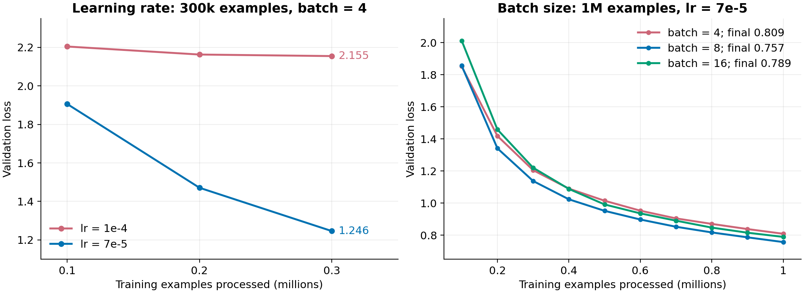
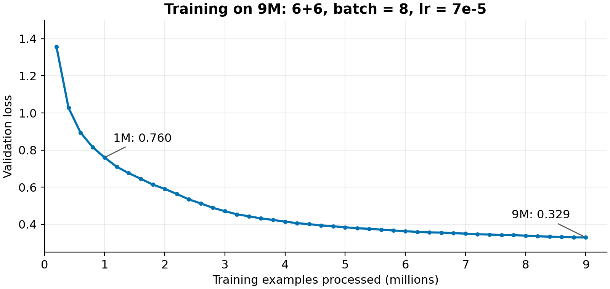

# Code Generation

Python code generation for solving word problems. This project was part of an [NLP homework assignment](TASK.md): train an encoder-decoder Transformer from scratch and generate answers for the entire test set in no more than 180 seconds on a single NVIDIA T4.

The model was trained on [SlavaYus/tinysms_qa_12m](https://huggingface.co/datasets/SlavaYus/tinysms_qa_12m). It takes a problem statement as input and generates code to solve it.

## Model and tokenization

Tokenization uses byte-level BPE with a vocabulary of 16 000 tokens. It can encode arbitrary text.

The model uses the `google-t5/t5-small` configuration. Weights are randomly initialized, and the model is trained from scratch. The experiments varied the number of encoder and decoder layers, learning rate, batch size, and FFN type. When replacing ReLU with gated-GELU, the FFN dimension was reduced from 2048 to 1408 to keep roughly the same number of parameters.

## Project structure

```text
main.py                 — run training and answer generation
configs/                — base config and experiment settings
src/
├── dataset/
│   ├── dataset.py      — data loading, tokenization, and caching
│   └── collate.py      — batch preparation: truncation, EOS, masks, and padding
├── models/
│   ├── tokenizer.py    — BPE tokenizer training and loading
│   └── model.py        — T5 initialization, forward pass, and generation
├── scripts/
│   ├── train.py        — training, validation, and learning rate updates
│   └── inference.py    — code generation and saving answers to JSONL
└── utils/
    ├── config.py       — load a config from a Python file
    ├── checkpoint.py   — save and load training state
    ├── logging.py      — metrics and code samples in Comet, offline logs
    └── utils.py        — set the seed for reproducibility
```

## Running

```bash
uv sync --locked
```

Run an experiment:

```bash
uv run main.py --config configs/experiment.py
```

## Experiments

Early in training, the model often generated almost the same code for different prompts. To debug this, I ran small experiments on 128 examples. Lowering the learning rate helped the model memorize the training examples better and later improved training on larger datasets too.

With 100k examples, the model showed signs of learning, but generation quality was still low. Increasing the dataset to 1M improved the results further. I tested batch sizes of 4, 8, and 16. Batch size 8 gave the best result.



On 300k examples, lowering lr from 1e-4 to 7e-5 reduced the final loss from 2,155 to 1,246. On 1M, batch size 8 gave a loss of 0,757, batch size 16 - 0,789, and batch size 4 - 0,809.

After that, I started longer runs on 9M examples and compared intermediate results. All runs used batch size 8:

| Encoder layers | Decoder layers | LR | FFN | Config |
|---:|---:|---:|---|---|
| 6 | 6 | `7e-5` | ReLU | [baseline_9000k_bs8.py](configs/baseline_9000k_bs8.py) |
| 6 | 8 | `7e-5` | ReLU | [baseline_9000k_e6_d8_bs8.py](configs/baseline_9000k_e6_d8_bs8.py) |
| 8 | 6 | `7e-5` | ReLU | [baseline_9000k_e8_d6_bs8.py](configs/baseline_9000k_e8_d6_bs8.py) |
| 6 | 6 | `5e-5` | ReLU | [lower_lr5e5_9000k_bs8.py](configs/lower_lr5e5_9000k_bs8.py) |
| 6 | 6 | `7e-5` | gated-GELU | [baseline_9000k_gated_gelu_bs8.py](configs/baseline_9000k_gated_gelu_bs8.py) |

At comparable training steps, the last 4 experiments performed worse than the first, so I chose the 6+6 configuration with lr=`7e-5` and batch=8 for the final solution.


